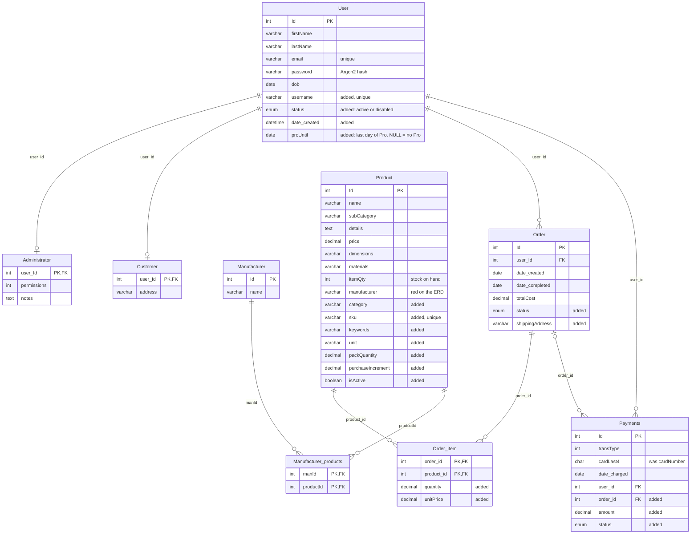
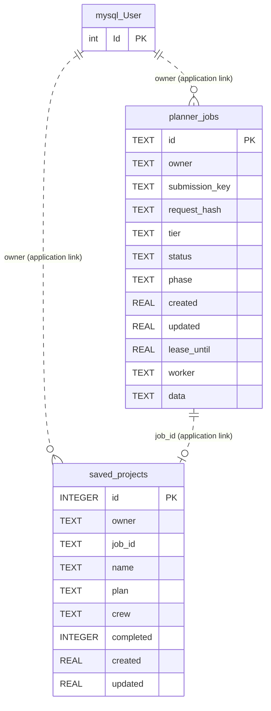

# BuildBetter database

## MySQL tables (team ERD)




## Planner job store (SQLite)

The application creates these two tables in `planning/jobs.py`. Their `owner` values contain a MySQL `User.Id` as text, and `saved_projects.job_id` identifies a planner job. SQLite does not declare foreign keys for either link, so the dashed connections below show application-level references only. `saved_projects.plan` and `crew`, and `planner_jobs.data`, contain JSON text.



SQLite enforces `UNIQUE(owner, submission_key)` on `planner_jobs` and `UNIQUE(owner, job_id)` on `saved_projects`. The ERD has no MySQL tables for projects or material lists, so AI plans and saved projects live only in this SQLite file.

## Planner result JSON

`planner_jobs.data` stores each job's inputs and its result as JSON. `saved_projects.plan` stores a copy of the job's `tier`, `project`, `answers` and `result`. A job keeps one result, with no versions or stage snapshots. A failed job is never resumed: **Start again** creates a new job from the same `project` and `answers`.

The result uses the same shape at every step: each AI estimate stage returns it, `run_stage` validates it once on arrival (Pydantic models in `planning/schemas.py`), and after that it is a plain dictionary in storage and in the templates.

```json
{
  "planning_status": "partial",
  "summary": "12 x 16 ft pressure-treated deck, 3 ft above ground.",
  "materials": [
    {
      "material_name": "Pressure-treated deck board",
      "specification": "5/4 x 6 in x 16 ft",
      "quantity": 36,
      "unit": "piece",
      "waste_percent": 10,
      "round_up": true,
      "calculation": {"method": "count", "inputs": [{"name": "count", "value": 32, "unit": "piece"}]},
      "notes": "Boards run the 16 ft length; 32 rows plus waste.",
      "product_id": 1003
    },
    {
      "material_name": "Footing concrete",
      "specification": "Design-dependent",
      "quantity": null,
      "unit": "cu_ft",
      "waste_percent": 0,
      "round_up": false,
      "calculation": {"method": "manual", "inputs": []},
      "notes": "Unknown: footing size and count need a local design.",
      "product_id": null
    }
  ],
  "assumptions": ["Joists 16 in on center"],
  "warnings": ["Footings, beams and posts need local design approval."]
}
```

- `quantity` is the amount the project **needs**, in `unit`, with waste included. It is `null` when the details given are not enough to calculate it; `notes` then says what is missing. A quantity is never invented.
- Python recalculates `quantity` from `calculation` for every method except `manual` (`check_estimate`).
- `product_id` is `Product.Id`. It is `null` unless the ID belongs to an active product in the catalog the planner was given; any other ID is removed before the result is saved.
- `planning_status` is added by Python: `partial` when any quantity is `null`, otherwise `complete`.
- The purchase quantity is kept separate from the required quantity. It is never stored; the plan page works it out from database product data (`planning/presentation.py`). The page shows it only when the material's unit matches `Product.unit`, rounded up to `Product.purchaseIncrement`. When the units differ (for example `sq_ft` of decking and a `piece` of board), the page leaves the choice to the user.

### Product fields

The JSON stores only `product_id`. Everything else about a product is read from MySQL whenever a plan is shown (`services/products.py` `get_products_by_ids`). The queries rename the columns with `AS`, so the code can tell a product's name and price apart from a material's:

| Name in the code and pages | `Product` column |
| --- | --- |
| `product_id` | `Id` |
| `product_name` | `name` |
| `unit_price` | `price` |
| `available_quantity` | `itemQty` |
| `unit` | `unit` |
| `purchase_increment` | `purchaseIncrement` |
