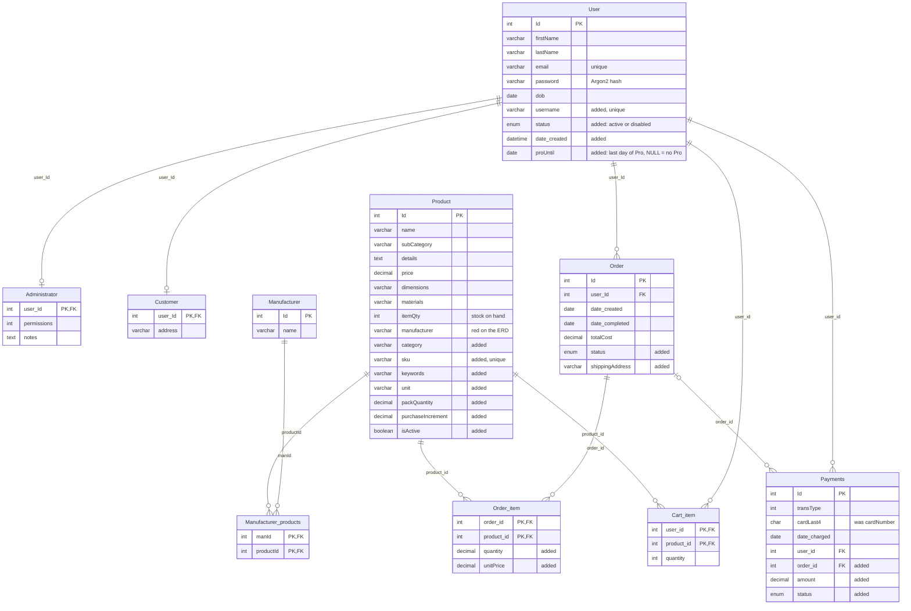
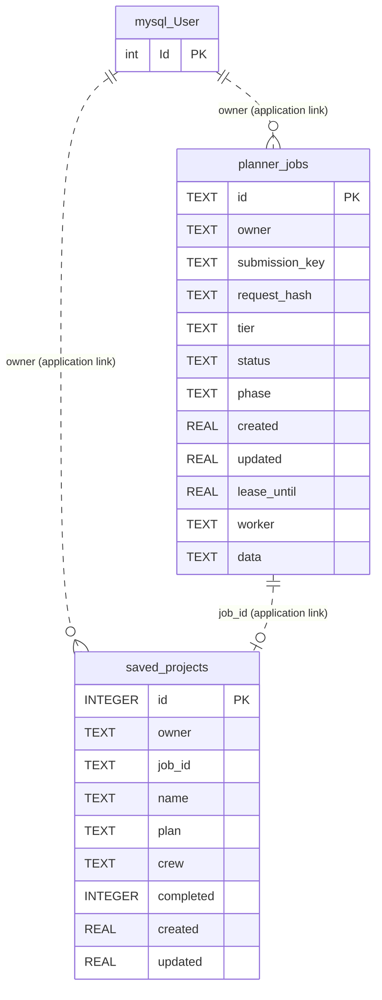

# BuildBetter database

## MySQL tables (team ERD)




## Shopping cart

Run `sql/erd_schema.sql` to create `Construction_db` and all of its MySQL tables, including the cart. The script uses `IF NOT EXISTS`, so running it again keeps existing tables and data.

Each user/product pair has one row. Quantities are positive whole numbers. Adding the same product increases its quantity; updating replaces it. Product prices, purchase increments and stock are read from `Product` each time. Adding to a cart does not reserve or reduce stock.

`services/cart.py` checks stock and purchase increments before saving. Unavailable items remain visible with an explanation and can be removed. The cart shows current prices and totals in cents, calculated with `Decimal`. Shipping and estimated tax are zero for this demo because delivery and tax rules are not configured. Checkout and order persistence helpers remain unfinished.

To include the cart database tests in PowerShell, set `$env:RUN_CART_DB_TESTS="1"` and run `.venv\Scripts\python.exe -B -m unittest discover -s tests`. These tests require `localhost / Construction_db_test`, create temporary test records, and remove those records afterward. They expect the cart table to exist already.

## Planner job store (SQLite)

The application creates these two tables in `planning/jobs.py`. Their `owner` values contain a MySQL `User.Id` as text, and `saved_projects.job_id` identifies a planner job. SQLite does not declare foreign keys for either link, so the dashed connections below show application-level references only. `saved_projects.plan` and `crew`, and `planner_jobs.data`, contain JSON text.



SQLite enforces `UNIQUE(owner, submission_key)` on `planner_jobs` and `UNIQUE(owner, job_id)` on `saved_projects`. The ERD has no MySQL tables for projects or material lists, so AI plans and saved projects live only in this SQLite file.

## Planner result JSON

`planner_jobs.data` stores each job's inputs and its result as JSON. `saved_projects.plan` stores a copy of the job's `tier`, `project`, `answers` and `result`. A job keeps one result, with no versions or stage snapshots. A failed job is never resumed: **Start again** creates a new job from the same `project` and `answers`.

Every stage receives `project`, `answers` and `details`. The interpreter returns details and questions, and planners return materials only. The auditor receives `estimates`: one draft for Fast/Standard, two for Pro (or one if a Pro planner fails). It returns the final summary, materials, project notes and crew. Python adds the crew label and completion status. `run_stage` checks required fields, positive finite quantities, catalog IDs and crew data before storing a plain dictionary.

```json
{
  "planning_status": "complete",
  "summary": "12 x 16 ft pressure-treated deck, 3 ft above ground.",
  "materials": [
    {
      "material_name": "Pressure-treated deck board",
      "specification": "5/4 x 6 in x 16 ft",
      "quantity": 36,
      "unit": "piece",
      "notes": "Boards run the 16 ft length; 32 rows plus 10% waste, rounded up to 36.",
      "product_id": 1003
    },
    {
      "material_name": "Exterior wood finish",
      "specification": "Finish for the deck surface",
      "quantity": 1,
      "unit": "gallon",
      "notes": "Assume one coat over 192 sq ft at 350 sq ft per gallon: 192 / 350 x 1.1, rounded up to 1 gallon.",
      "product_id": null
    }
  ],
  "notes": ["Drying time depends on weather."],
  "crew": {
    "label": "AI-estimated crew",
    "days": [3, 5],
    "members": [{"role": "carpenter", "workers": 2, "days": [3, 5]}]
  }
}
```

- `quantity` is the amount the project **needs**, in `unit`, with waste included. Every listed material must have a finite number greater than zero. Missing details use reasonable assumptions explained in `notes`; zero, missing, and null quantities are rejected.
- The auditor reviews arithmetic, waste, rounding and suitability. Python does not recalculate material quantities. Material notes explain each amount; project notes cover shared assumptions and uncertainty. Older saved assumptions/warnings are displayed together as notes.
- `product_id` is `Product.Id`. It is `null` unless the ID belongs to an active product in the catalog the planner was given; any other ID is removed before the result is saved.
- `planning_status` is `complete` after validation succeeds. Invalid answers use the existing retry; if validation still fails, the job fails instead of saving an incomplete estimate. Older stored plans may still have `partial` status and need to be generated again.
- The purchase quantity is kept separate from the required quantity. It is never stored; the plan page works it out from database product data (`planning/presentation.py`). The page shows it only when the material's unit matches `Product.unit`, rounded up to `Product.purchaseIncrement`. When the units differ (for example `sq_ft` of decking and a `piece` of board), the page leaves the choice to the user.

### Product fields

The JSON stores only `product_id`. Everything else about a product is read from MySQL whenever a plan is shown (`services/products.py` `get_products_by_ids`). The queries rename the columns with `AS`, so the code can tell a product's name and price apart from a material's:

| Name in the code and pages | `Product` column |
| --- | --- |
| `product_id` | `Id` |
| `product_name` | `name` |
| `unit_price` | `price` |
| `available_quantity` | `itemQty` |
| `unit` | `unit` |
| `purchase_increment` | `purchaseIncrement` |
