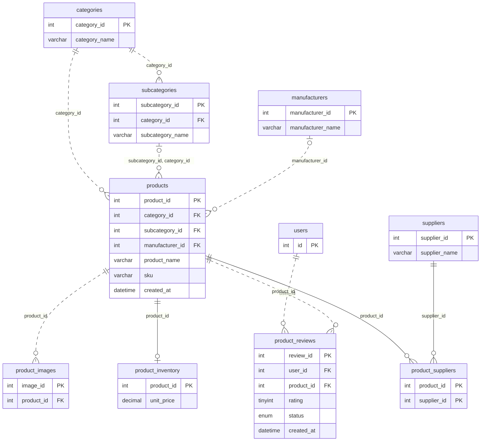
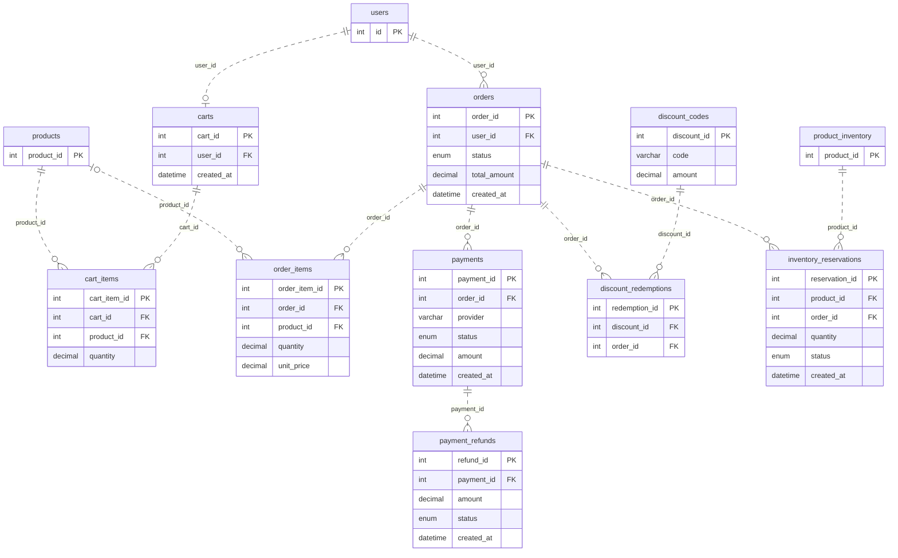
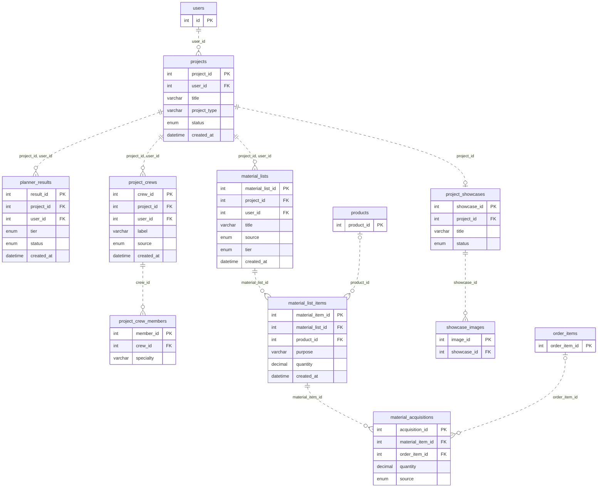
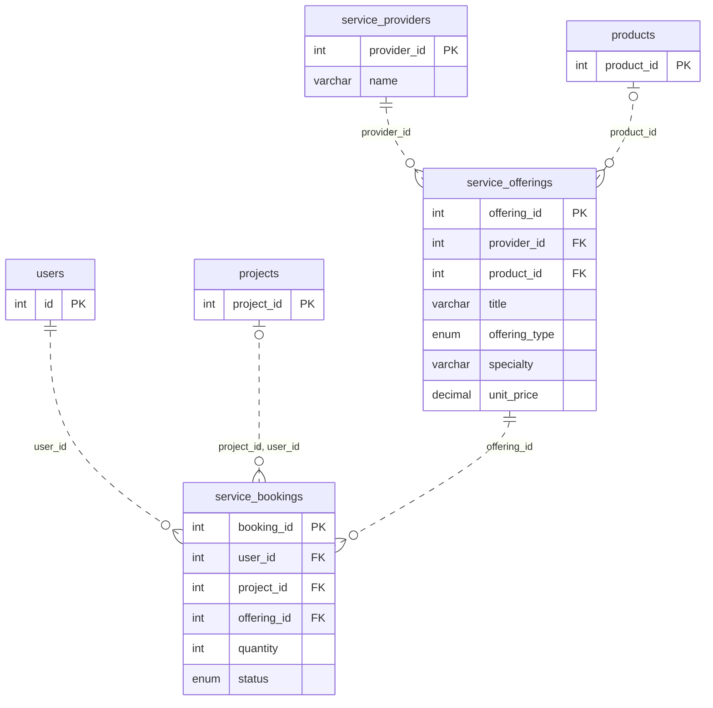
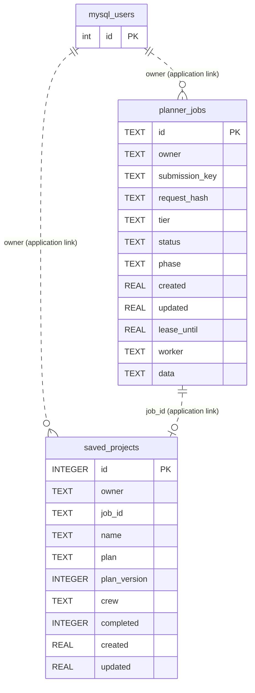

erDiagram
    users {
        int id PK
        varchar username
        varchar email
        enum status
        datetime created_at
    }
    account_tokens {
        int token_id PK
        int user_id FK
        enum purpose
        datetime created_at
    }
    auth_identities {
        int identity_id PK
        int user_id FK
        enum provider
    }
    user_addresses {
        int address_id PK
        int user_id FK
        varchar label
        datetime created_at
    }
    notification_preferences {
        int user_id PK
    }
    notification_outbox {
        int notification_id PK
        int user_id FK
        int project_id FK
        varchar template_key
        enum status
    }
    saved_payment_methods {
        int method_id PK
        int user_id FK
        varchar provider
    }
    subscriptions {
        int subscription_id PK
        int user_id FK
        varchar plan_name
        enum status
        varchar provider
        datetime created_at
    }
    subscription_invoices {
        int invoice_id PK
        int subscription_id FK
        decimal amount
        enum status
    }
    projects {
        int project_id PK
    }
    users ||..o{ account_tokens : "user_id"
    users ||..o{ auth_identities : "user_id"
    users ||..o{ notification_outbox : "user_id"
    projects o|..o{ notification_outbox : "project_id, user_id"
    users ||--o| notification_preferences : "user_id"
    users ||..o{ saved_payment_methods : "user_id"
    subscriptions ||..o{ subscription_invoices : "subscription_id"
    users ||..o{ subscriptions : "user_id"
    users ||..o{ user_addresses : "user_id"
```

## Product catalog



## Cart, orders, and payments



## Projects and materials



## Service bookings



## Planner job store (SQLite)

The application creates these two tables in `planning/jobs.py`. Their `owner` values contain a MySQL user ID as text, and `saved_projects.job_id` identifies a planner job. SQLite does not declare foreign keys for either link, so the dashed connections below show application-level references only. `saved_projects.plan` and `crew`, and `planner_jobs.data`, contain JSON text.



SQLite enforces `UNIQUE(owner, submission_key)` on `planner_jobs` and `UNIQUE(owner, job_id)` on `saved_projects`. The MySQL `projects.source_job_id`, `planner_results.source_job_id`, and `material_lists.source_job_id` also refer to planner jobs by value without cross-database foreign keys.
